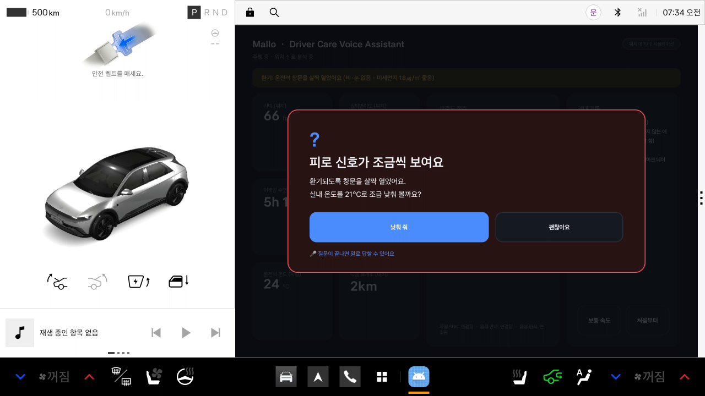
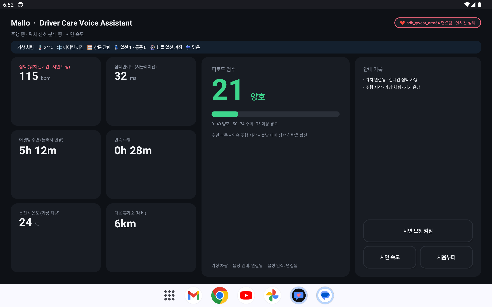
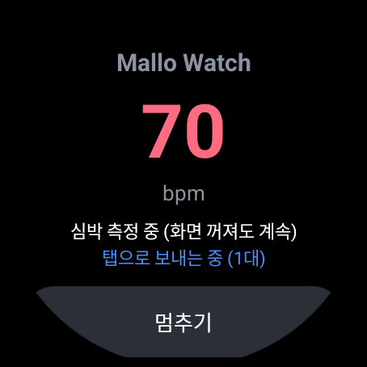
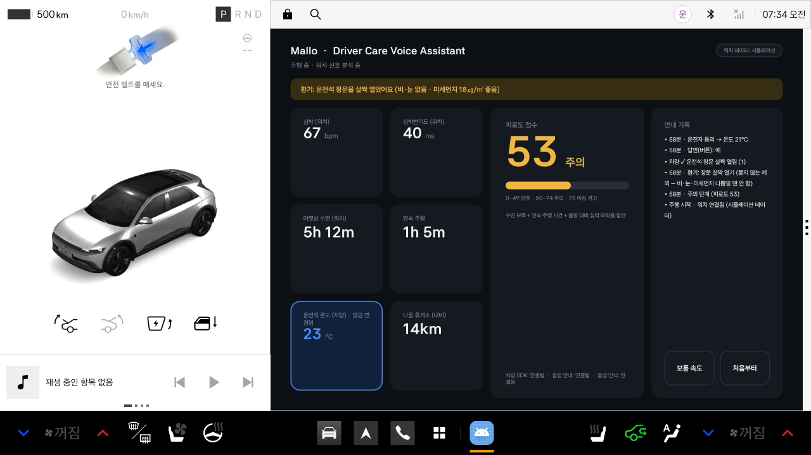
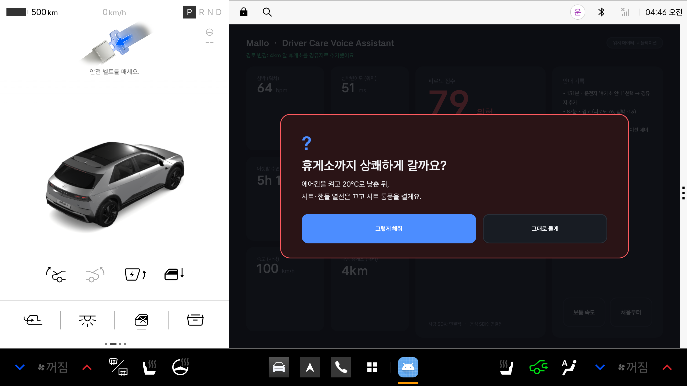
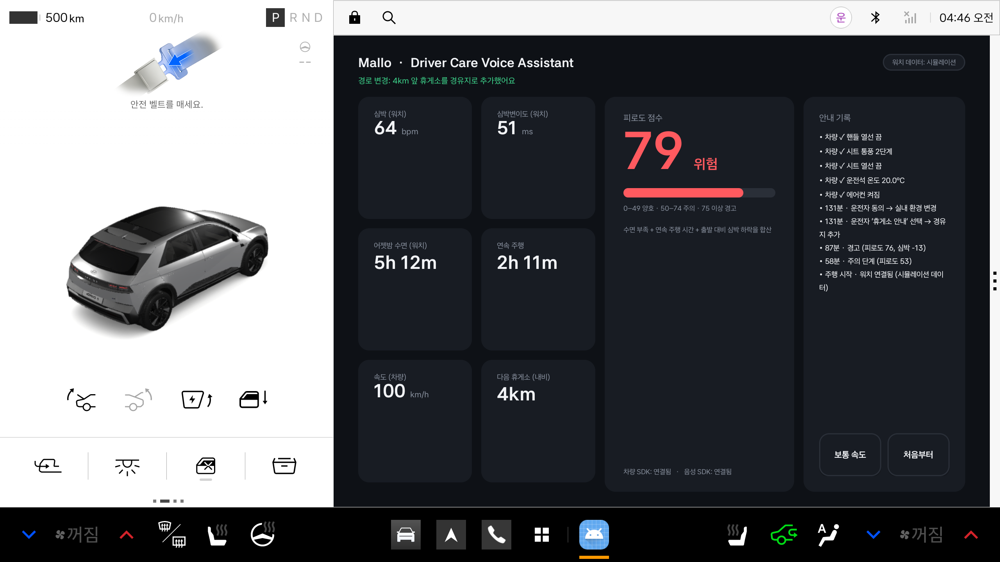

# Mallo – Driver Care Voice Assistant

**스마트워치 실시간 심박과 차량 정보로 운전자의 피로를 알아채고, 먼저 말을 건 뒤 운전자가 말 한마디로 동의하면 차를 맞춰 주는 Pleos Connect용 운전자 케어 음성 비서입니다.**

현대자동차그룹 차량용 앱 개발 공모전(2026) 출품작 · 디엔에이랩스(DNALabs)



## 구성

| 앱 | 설치 기기 | 하는 일 |
| --- | --- | --- |
| **Mallo** (`apk/DNALabs_Mallo_release.apk`) | Pleos Connect 차량·에뮬레이터, 또는 갤럭시 탭 등 안드로이드 태블릿 | 피로도 계산, 음성 질문·대답, 차량(또는 가상 차량) 제어 |
| **Mallo Watch** (`apk/DNALabs_MalloWatch_release.apk`) | 갤럭시 워치4 이상 (Wear OS) | 심박을 계속 측정해 블루투스로 Mallo에 실시간 전송 |

```
갤럭시 워치 ──(블루투스 표준 심박 서비스)──▶ Mallo (차량 화면 / 갤럭시 탭)
 Health Services 심박 측정                    피로도 계산 → 음성 질문 → 동의 → 차량 제어
```

- 워치 → 차량(탭) **직접 연결**이라 휴대폰·와이파이가 필요 없습니다.
- 워치는 블루투스 표준 **Heart Rate Service(0x180D)** 로 심박을 보내므로, 폴라·가민 등 일반 블루투스 심박 벨트도 그대로 연결됩니다.
- 워치 앱은 구글 Wear OS 표준 **Health Services**(운동 측정)를 사용해 화면이 꺼져도 5초 간격으로 심박을 보냅니다. 삼성 별도 승인이 필요 없습니다.
- Mallo는 실행된 기기를 스스로 판단합니다.
  - **Pleos 차량/에뮬레이터**: Pleos Vehicle·TextToSpeech·SpeechToText SDK로 실제 차량 기능 제어
  - **일반 태블릿**: 화면 위쪽 '가상 차량' 줄에 온도·에어컨·창문·열선 상태를 보여 주고, 기기 기본 음성 합성·음성 인식 사용

## 핵심 기능

| 기능 | 설명 |
| --- | --- |
| 실시간 심박 | 갤럭시 워치(Mallo Watch) 또는 블루투스 심박 벨트 연결. 안정된 뒤 40회 측정의 중간값을 출발 기준 심박으로 사용. 연결 전에는 시뮬레이션 값 |
| 피로도 계산 | 수면 부족 + 연속 주행 시간 + 출발 대비 심박 하락으로 0~100점 |
| 주의 단계 (50~74점) | 운전석 창문을 살짝 열고(비·눈·미세먼지 나쁨일 땐 안 함) "실내 온도도 조금 낮춰 볼까요?" → 동의 시 24→23→22→21°C로 한 칸씩 |
| 경고 단계 (75점 이상) | "졸음 신호가 감지됐어요. 휴게소에서 쉬어 가시겠어요?" |
| 동의 후 실내 환경 변경 | 에어컨 켜기, 20°C, 시트·핸들 열선 끄기, 시트 통풍 2단계 |
| 음성으로 답하기 | "응", "아니", "그렇게 해줘", "괜찮아" 등 음성 대답 인식 (버튼도 가능) |

**동의 기반 제어 원칙**: 차량 기능을 바꾸기 전에 먼저 묻고, 운전자가 동의할 때만 실행합니다. 예외로 창문 살짝 열기는 안내만 하고 바로 실행하되, 비·눈이 오거나(와이퍼 작동) 미세먼지가 나쁘면 열지 않습니다. 주행 중에는 등받이 등 자세를 바꾸는 기능을 쓰지 않습니다.

## 사용한 SDK

| SDK | 버전 | 용도 |
| --- | --- | --- |
| Pleos Vehicle | 2.3.2 | 에어컨, 온도, 시트·핸들 열선, 시트 통풍, 공조 전원, 운전석 창문 위치, 와이퍼 상태(비·눈 판단) |
| Pleos TextToSpeech | 3.3.1 | 질문·안내 음성 (ON_DEVICE) |
| Pleos SpeechToText | 3.3.1 | 음성 대답 인식 (ON_DEVICE, ko-KR) |
| Android Bluetooth LE | – | 워치 심박 수신 (Heart Rate Service 0x180D / Measurement 0x2A37) |
| AndroidX Health Services (워치) | 1.1.0-alpha05 | 갤럭시 워치 심박 측정 (ExerciseClient, 화면 꺼짐 시 5초 배치) |

## APK 위치

- `apk/DNALabs_Mallo_release.apk` — 차량·태블릿용 (release 서명, versionName 0.2.0)
- `apk/DNALabs_MalloWatch_release.apk` — 갤럭시 워치용 (release 서명, versionName 0.2.0)

## 테스트 환경 및 필요한 설정

- Pleos Connect Emulator **v2.1.0** (Android 14 / API 34, `system-images;android-34;pleos_car_emulator;arm64-v8a`)
- Android 태블릿 에뮬레이터 (Pixel Tablet, API 34) + Wear OS 에뮬레이터 (Wear OS 5, API 34) — 두 에뮬레이터 사이 블루투스 심박 연결 확인
- 실기기 대상: 갤럭시 탭(Android 12 이상) + 갤럭시 워치4 이상(Wear OS 3 이상)
- 개발 환경: Android Studio, Gradle 8.14.3 (wrapper 포함), JDK 17 이상, 태블릿 앱 minSdk 28 / 워치 앱 minSdk 30, compileSdk 35
- **권한**
  - Mallo: 마이크(음성 대답), 근처 기기(블루투스로 워치 찾기)
  - Mallo Watch: 신체 센서(심박), 신체 활동, 근처 기기, 알림
- **마이크 (Pleos 에뮬레이터)**: Extended Controls → Microphone → "Virtual microphone uses host audio input"을 켭니다. 명령줄 실행 시 `-allow-host-audio` 옵션을 붙입니다.

## 실행 방법

### 1) 태블릿(또는 Pleos 에뮬레이터)에 Mallo 설치

```bash
adb install apk/DNALabs_Mallo_release.apk
adb shell am start -n ai.dnalabs.drivecare/.MainActivity
```

태블릿에서는 GitHub에서 APK를 내려받아 바로 설치해도 됩니다(출처를 알 수 없는 앱 설치 허용 필요). 처음 실행할 때 마이크·근처 기기 권한을 허용합니다.

### 2) 갤럭시 워치에 Mallo Watch 설치

1. 워치: 설정 → 시계 정보 → 소프트웨어 정보 → **소프트웨어 버전을 5번 누르기** (개발자 옵션 켜짐)
2. 워치: 설정 → 개발자 옵션 → **ADB 디버깅** 켜기 → **무선 디버깅** 켜기 → **새 기기 페어링** (IP:포트와 6자리 코드 표시)
3. 컴퓨터(워치와 같은 와이파이):

```bash
adb pair <워치IP>:<페어링포트>      # 6자리 코드 입력
adb connect <워치IP>:<무선디버깅포트>
adb -s <워치IP>:<무선디버깅포트> install apk/DNALabs_MalloWatch_release.apk
```

4. 워치에서 **Mallo Watch** 실행 → 권한 허용 → 심박이 보이면 "탭 연결 기다리는 중"

### 3) 연결

- 태블릿 Mallo 오른쪽 위 **⌚ 워치 찾는 중** 표시가 **❤ … 연결됨 · 실시간 심박**으로 바뀌면 완료입니다 (블루투스가 켜져 있어야 합니다).
- 표시를 누르면 연결을 끄거나 다시 찾습니다.

### 소스에서 빌드

```bash
./gradlew :app:assembleDebug      # 차량·태블릿 앱
./gradlew :wear:assembleDebug     # 워치 앱
```

Pleos SDK는 `settings.gradle`에 등록된 Pleos 저장소(`https://nexus-playground.pleos.ai/repository/maven-releases/`)에서 받습니다.

### 데모 순서

1. 앱이 열리면 자동으로 주행 시뮬레이션이 시작됩니다 (**시연 속도**: 1초 = 주행 1분).
2. 오른쪽 아래 속도 버튼으로 **시연 속도 → 빠르게 ×4 → 실제 시간**을 바꿉니다. 실제 운전처럼 쓰려면 '실제 시간'을 고릅니다.
3. 워치가 연결되면 심박 칸이 **워치 실시간**으로 바뀝니다. 짧은 시연에서도 졸음 단계를 볼 수 있도록 **시연 보정**(실제 심박에 졸음 패턴 최대 -13bpm을 더함)이 기본으로 켜져 있으며, 버튼으로 끌 수 있습니다.
4. '어젯밤 수면' 칸을 누르면 수면 시간을 바꿀 수 있습니다.
5. 주의 질문·졸음 경고가 나오면 음성이 끝난 뒤 "응" 또는 "아니"라고 말하거나 버튼을 누릅니다.
6. **휴게소 안내** → **그렇게 해줘**를 고르면 안내 기록에 차량 제어 결과(✓)가 표시됩니다.

시험용 명령: `adb shell am start -f 0x20000000 -n ai.dnalabs.drivecare/.MainActivity --es weather rain` (또는 `dust`, `clear`) — 주의 단계에서 창문을 열지 않는지 확인. 미세먼지는 데모에서 시뮬레이션 값이며, 출시 버전은 에어코리아 공공 API를 연동합니다.

## 화면

| 태블릿: 워치 실시간 심박 + 가상 차량 | 갤럭시 워치: Mallo Watch |
| --- | --- |
|  |  |

| 창문 환기 + 온도 한 칸씩 (Pleos) | 휴게소 안내 후 질문 | 동의 후 차량 제어 결과 |
| --- | --- | --- |
|  |  |  |

## 개발 예정

- NaviHelper SDK로 휴게소 경유지 추가, FusedLocation SDK로 실제 휴게소 거리 계산
- 정차(P단) 시에만 등받이 등 자세 변경 제안
- Health Connect 수면 기록 연동(어젯밤 수면 자동 입력), 심박변이도(HRV) 실측 연동
- 에어코리아 미세먼지 API 연동

## 안내

Mallo는 의료 진단 기기가 아니라 안전 운전을 돕는 안내 서비스입니다. 심박 외의 워치 데이터(수면·심박변이도)와 주행 정보는 데모에서 시뮬레이션 값입니다.
